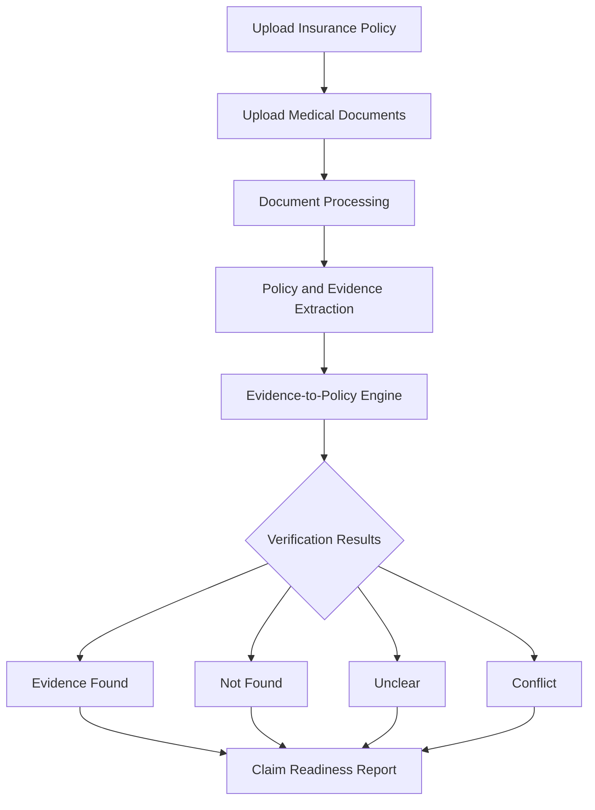

# 🛡️ CLAIMREADY — Micro-Insurance Claim Settlement Assistance

<div align="center">

[](https://github.com/SiyaChaudhary1107/claimready)
[](https://claim-ready-teal.vercel.app/)
[](https://react.dev/)
[](https://www.typescriptlang.org/)
[](https://tailwindcss.com/)
[](https://github.com/SiyaChaudhary1107/claimready)

**Your insurance claim, understood, checked and prepared.**

*A multilingual health-insurance claim preparation platform designed for gig workers, rural families, low-income households, and first-time policyholders.*

### 🌐 [Click Here to View the Live Application](https://claim-ready-teal.vercel.app/)

</div>

---

> **Responsible Technology Principle:** CLAIMREADY is an independent claim preparation assistant. It does not promise claim approval, make final coverage decisions, or replace an insurance company or Third-Party Administrator (TPA). Its purpose is to help users understand policy conditions, organize supporting documents, and identify information that may need further review.

---

## 🌟 1. Problem & Product Vision

### The Problem

For many first-time health-insurance policyholders, gig workers, rural families, and low-income households, preparing an insurance claim can be confusing and time-consuming.

Important information is often scattered across lengthy policy documents, hospital bills, discharge summaries, prescriptions, and payment receipts.

Common challenges include:

1. **Hidden Policy Sub-Limits:** Room-rent restrictions, ICU limits, exclusions, and waiting periods can be difficult to locate and understand.
2. **Unorganized Hospital Records:** Medical bills, discharge summaries, prescriptions, and diagnostic reports may contain inconsistent or incomplete information.
3. **Illegible Prescriptions:** Handwritten medical notes can be difficult to interpret accurately.
4. **Lack of Pre-Submission Guidance:** Policyholders may struggle to understand which documents and policy conditions need attention before approaching their insurer.
5. **Language Barriers:** Complex insurance terminology can make the process even harder for people unfamiliar with insurance documentation.

### The Solution: CLAIMREADY

CLAIMREADY acts as a smart claim preparation and document review platform designed to help users understand and organize their health-insurance claim information.

Its key capabilities include:

- 📄 **Policy Analysis:** Extracts and organizes relevant policy conditions, limits, exclusions, and waiting periods from uploaded documents.
- 🏥 **Medical Document Processing:** Reads information from bills, discharge summaries, prescriptions, and payment receipts using PDF processing and OCR technologies.
- ⚙️ **Evidence-to-Policy Intelligence Engine:** Compares available documentary evidence with relevant policy conditions.
- 🔎 **Explainable Findings:** Helps users understand why an item was flagged and where the supporting information was found.
- 📊 **Claim Readiness Report:** Generates a downloadable report summarizing findings and items that may require attention.
- 🗣️ **Multilingual Experience:** Supports English, Hindi (हिंदी), Punjabi (ਪੰਜਾਬੀ), and Bengali (বাংলা).

---

## 🚀 2. The Core Innovation: Evidence-to-Policy Intelligence Engine

The central innovation of CLAIMREADY is its **Evidence-to-Policy Intelligence Engine**.

Instead of providing generic insurance answers, the engine focuses on connecting information extracted from policy documents with evidence available in medical records.

It uses a structured, rule-based verification approach to classify findings into four distinct statuses.

| Status | Meaning | Example |
| :--- | :--- | :--- |
| 🟢 **`EVIDENCE FOUND`** | Supporting information has been identified in the reviewed documents. | Patient identity matches across the uploaded records. |
| ⚪ **`NOT FOUND`** | Expected information could not be identified in the uploaded documents. | A diagnostic report mentioned in the discharge summary is not present in the uploaded batch. |
| 🟡 **`UNCLEAR`** | Available information is incomplete, ambiguous, or requires human review. | A handwritten prescription cannot be confidently interpreted. |
| 🔴 **`CONFLICT`** | Two or more records contain inconsistent information, or a possible policy-limit discrepancy has been identified. | The discharge date differs between two uploaded documents. |

### Why This Matters

- **Evidence-Based:** Findings are connected to information available in the uploaded documents.
- **Explainable:** Users can understand the reason behind a finding.
- **Transparent:** Uncertain information is flagged instead of being presented as verified fact.
- **User-Centric:** Potential issues are highlighted for clarification before further claim processing.
- **Responsible:** Missing documents or date inconsistencies are not automatically treated as fraud or grounds for claim rejection.

> **Our Principle:** Every finding should help users understand what was identified, what could not be verified, and what may need human attention.

---

## ⚖️ 3. What Makes CLAIMREADY Different?

| Traditional Approach | CLAIMREADY |
| :--- | :--- |
| Manually reading lengthy policy documents | Organizes relevant policy information for easier review |
| Checking multiple medical documents separately | Reviews available documents together |
| Identifying inconsistencies manually | Highlights potential discrepancies |
| Generic insurance explanations | Evidence-based findings connected to source documents |
| Preparing checklists manually | Generates a structured claim readiness report |
| Language barriers | Multilingual user experience |
| Unclear next steps | Highlights information that may need further attention |

**Our differentiator:** CLAIMREADY focuses on document-grounded claim preparation and explainable evidence verification rather than acting as another generic AI chatbot.

---

## 🔄 4. How CLAIMREADY Works

The application follows a guided claim preparation workflow:

1. **Upload Insurance Policy:** Add the relevant health-insurance policy document.
2. **Upload Medical Records:** Add available hospital bills, prescriptions, discharge summaries, and receipts.
3. **Extract Information:** Process the uploaded documents using PDF text extraction and OCR where applicable.
4. **Analyze Policy Conditions:** Identify relevant policy information and conditions.
5. **Verify Evidence:** Compare extracted information with relevant policy conditions.
6. **Review Findings:** Explore evidence found, missing information, unclear entries, and potential conflicts.
7. **Generate Report:** Download a structured claim readiness report for further review.

### Workflow Diagram



---

## 💻 5. Technology Stack

| Technology | Purpose |
| :--- | :--- |
| **React 18** | Building the interactive user interface |
| **TypeScript** | Type-safe application development |
| **Tailwind CSS** | Responsive styling and UI design |
| **Vite** | Development server and build tooling |
| **PDF.js** | PDF text extraction and processing |
| **Tesseract.js** | Optical Character Recognition (OCR) |
| **JavaScript / TypeScript** | Application logic and verification rules |
| **jsPDF** | Generating downloadable PDF reports |

---

## 🏗️ 6. Project Structure

The application is organized around its main responsibilities:

```text
CLAIMREADY/
│
├── public/                 # Static assets
│
├── src/
│   ├── components/         # Reusable UI components
│   ├── pages/              # Application pages
│   ├── services/           # Document processing and application logic
│   ├── utils/              # Helper functions and verification rules
│   ├── assets/             # Images and other assets
│   ├── App.tsx             # Main application component
│   ├── main.tsx            # Application entry point
│   └── index.css           # Global styles
│
├── index.html
├── package.json
├── package-lock.json
├── tsconfig.json
├── vite.config.ts
├── tailwind.config.js
└── README.md
```

*Note: This is a logical overview. Actual folder and file names may differ depending on the current implementation.*

---

## 💻 7. Running the Application Locally

### Prerequisites

- Node.js installed
- npm installed
- Git installed
- A modern web browser

### Installation

Clone the repository:

```bash
git clone https://github.com/SiyaChaudhary1107/claimready.git
```

Navigate to the project folder:

```bash
cd claimready
```

Install dependencies:

```bash
npm install
```

Start the development server:

```bash
npm run dev
```

Open the local URL displayed in your terminal. The default Vite address is usually:

```text
http://localhost:5173
```

### Production Build

To build the application:

```bash
npm run build
```

To preview the production build:

```bash
npm run preview
```

---

## 🔐 8. Privacy & Responsible Technology

Health and insurance documents contain sensitive personal information. CLAIMREADY is designed with privacy and responsible document handling in mind.

Our principles include:

- Avoid unnecessary collection of personal information.
- Prefer local document processing wherever supported.
- Do not expose uploaded medical documents publicly.
- Avoid hardcoding API keys or credentials in frontend code.
- Clearly communicate whether document processing involves external services.
- Flag uncertain OCR results for manual verification.
- Avoid making unsupported coverage or claim-settlement decisions.

### Important Limitations

CLAIMREADY is a claim preparation assistant, not an insurance company, TPA, legal advisor, or medical professional.

It does not:

- Guarantee claim approval or settlement.
- Approve or reject insurance claims.
- Make final coverage or underwriting decisions.
- Replace the insurer's official claim submission process.

All extracted information and potential discrepancies should be reviewed by the user and, where necessary, the relevant hospital or insurer.

---

## 🌍 9. Target Users & Expected Impact

CLAIMREADY is designed to make health-insurance documentation more accessible to:

- Gig workers and daily-wage earners.
- Rural and underserved households.
- Low-income families.
- First-time health-insurance policyholders.
- People unfamiliar with complex insurance terminology.

### Expected Impact

- Improve understanding of policy conditions.
- Reduce confusion during claim preparation.
- Help users organize supporting medical documents.
- Highlight potential inconsistencies for clarification.
- Improve accessibility through multilingual support.
- Help policyholders prepare more informed questions for hospitals and insurers.

Our vision is to make insurance claim preparation easier, clearer, and more accessible for everyone.

---

## 🛣️ 10. Future Scope

Potential future improvements include:

- Integration with Azure AI Document Intelligence for advanced document extraction.
- Improved support for handwritten and low-quality medical documents.
- Expansion to additional Indian regional languages.
- More advanced policy-condition extraction and validation.
- Secure document storage with explicit user consent.
- Accessibility improvements for users with limited digital literacy.
- Integration with authorized insurer workflows through suitable partnerships and APIs.
- Expansion into accident and other micro-insurance claim categories.

---

## 📸 11. Live Demo

<div align="center">

### 🌐 [OPEN CLAIMREADY — LIVE APPLICATION](https://claim-ready-teal.vercel.app/)

[](https://github.com/SiyaChaudhary1107/claimready)

</div>

---

## 👩‍💻 12. Project Information

| Detail | Information |
| :--- | :--- |
| **Project Name** | CLAIMREADY |
| **Hackathon Track** | Micro-Insurance Claim Settlement Assistance |
| **Primary Focus** | Health Insurance |
| **Platform** | Web Application |
| **Frontend** | React + TypeScript |
| **Repository** | [GitHub](https://github.com/SiyaChaudhary1107/claimready) |
| **Live Application** | [CLAIMREADY](https://claim-ready-teal.vercel.app/) |

---

<div align="center">

### 🛡️ CLAIMREADY

**Understand your policy. Organize your evidence. Prepare with confidence.**

*Making insurance documentation easier to understand, one claim at a time.*

</div>
